# 🛡️ Awesome Linters & Code Quality

  

      

---

## 📌 Top Linters & Code Quality Ecosystem

> **A curated showcase of premier SaaS platforms & top-tier open-source projects for Static Application Security Testing (SAST), automated linters, vulnerability detection, and code quality automation.**

Welcome to the definitive, SEO-optimized directory of **Linters, Static Code Analyzers, and Automated Code Review Platforms**. Whether you are looking for enterprise-grade continuous security scanning (SAST/DAST) or blazing-fast native CLI linters (Rust/Go/C++) for pre-commit hooks, this repository indexes the best-in-class tools to eliminate code smells, enforce idioms, and prevent software vulnerabilities before deployment.

---

## 📑 Table of Contents

- [🌐 Sector Overview & Market Dynamics](#-sector-overview--market-dynamics)
- [☁️ SaaS & Hosted Platforms](#️-saas--hosted-platforms)
- [💻 Open-Source GitHub Projects](#-open-source-github-projects)
  - [🚀 Top Open-Source Linters & Scanners (Ranked by Stars)](#-top-open-source-linters--scanners-ranked-by-stars)
  - [🧩 Architectural Combinations & Best Practices](#-architectural-combinations--best-practices)
- [🤝 How to Contribute](#-how-to-contribute)
- [⚠️ Disclaimer & Compliance](#️-disclaimer--compliance)
- [⭐ Star History](#-star-history)
- [💖 Support & Sponsoring](#-support--sponsoring)

---

## 🌐 Sector Overview & Market Dynamics

The global **Static Application Security Testing (SAST) and Automated Code Quality market** was valued at approximately **$4.2 Billion in 2024** and is projected to surpass **$11.8 Billion by 2032**, expanding at a robust **CAGR of ~14.2%**. This growth is fueled by the rapid shift-left security paradigm, regulatory compliance pressures (SOC 2, PCI-DSS, ISO 27001), and the proliferation of AI-assisted code generation which significantly elevates the volume of untested code commits.

From a market structure perspective, the sector exhibits **moderate fragmentation transitioning towards tiered consolidation**. The upper enterprise tier is led by heavyweight infrastructure vendors (Microsoft/GitHub, Synopsys, Veracode, Checkmarx) providing end-to-end security governance suites. Concurrently, specialized developer-first platforms (Sonar, Snyk, JetBrains Qodana) and ultra-fast native toolchains (Astral/Ruff, Biome, VoidZero/Oxlint) command vibrant ecosystems. The market is not a singular "winner-take-all" landscape; rather, platform teams increasingly deploy a hybrid strategy combining enterprise governance platforms with best-in-class, modular open-source linters in local IDEs and CI/CD pipelines.

---

## ☁️ SaaS & Hosted Platforms

The following table summarizes the market leaders in hosted static analysis, automated pull request review, and continuous code quality platforms. Entries are sorted descending by **Company Scale (Valuation / Revenue)**.

| 🏢 Platform | 💰 Company Scale (Valuation / ARR) | 💵 Starting Pricing | 🎁 Free Tier & Trial Limits | 🔍 Core Capabilities & Coverage |
| :--- | :--- | :--- | :--- | :--- |
| **[GitHub Advanced Security](https://github.com/features/security)** | **$3.1 Trillion** (Microsoft parent / $1B+ GitHub ARR) | **$49 / active committer / month** (billed annually as Enterprise add-on) | **100% Free forever** for all public open-source repos; 30-day GitHub Enterprise Cloud trial | Deep semantic code scanning via CodeQL, automated secret scanning with push protection, and real-time dependency vulnerability alerts. |
| **[Coverity](https://www.synopsys.com/)** | **$80+ Billion** (Synopsys parent / $2.1B Software Integrity Group) | **$1,500 / developer / year** (~$125/month base tier) | **Free forever for open-source** via Coverity Scan; 30-day enterprise evaluation trial | Deep interprocedural static analysis, enterprise-grade taint tracking, high-accuracy concurrency defect detection for C/C++, Java, and C#. |
| **[Snyk Code](https://snyk.io/)** | **$7.4 Billion** (Peak valuation / ~$200M ARR) | **$25 / product / month** (Team Plan starting tier) | **Free forever plan** with 100 code tests/month + unlimited open-source test scans | Real-time AI engine trained on security fixes, semantic SAST, automated 1-click pull request remediations, and multi-cloud CI/CD integration. |
| **[SonarQube / SonarCloud](https://www.sonarsource.com/)** | **$4.7 Billion** (Valuation / ~$200M ARR) | **$10 / month** (SonarCloud starting tier for 100k lines of code) | **Free forever** for public repos & Community Edition (self-hosted LGPL v3); 14-day private cloud trial | The gold standard for Clean Code: detects bugs, vulnerabilities, and code smells across 30+ languages with customizable Quality Gates. |
| **[Veracode](https://www.veracode.com/)** | **$2.5 Billion** (Acquisition valuation / ~$300M ARR) | **$833 / month** ($10,000/year annual base package) | **14-day guided trial** with up to 5 full application scans (no permanent private free tier) | End-to-end AppSec governance platform combining SAST, DAST, SCA, policy compliance certifications, and developer remediation coaching. |
| **[Checkmarx One](https://checkmarx.com/)** | **$1.15 Billion** (Acquisition valuation / ~$180M ARR) | **$667 / month** ($8,000/year enterprise team tier) | **14-day full feature trial**; permanently free open-source KICS IaC scanner utility | Comprehensive Application Security Testing (AST) platform including SAST, API security scanning, software supply chain security, and IDE plugins. |
| **[Qodana](https://www.jetbrains.com/qodana/)** | **$450 Million** (JetBrains annual revenue) | **$6 / contributor / month** (Ultimate plan, billed annually) | **Free Community tier forever** for core JVM/JS/Python/PHP inspections; 60-day full Ultimate trial | Server-side static analysis engine powered by JetBrains IDE inspections, offering cloud dashboards, quality gates, and seamless JetBrains integration. |
| **[Code Climate](https://codeclimate.com/)** | **$120 Million** (Tricentis acquisition / $350M+ ARR) | **$20 / seat / month** (Developer plan) | **Free forever** for public open-source repos; 14-day free trial on private repositories | Automated pull request code review tracking 10-point GPA maintainability, test coverage regressions, and engineering velocity metrics. |
| **[Codacy](https://www.codacy.com/)** | **$100 Million** (Estimated valuation / $23M raised) | **$15 / user / month** (Pro plan, billed annually) | **Free forever** for open-source projects & 1 user on private repositories; 14-day trial of Pro | Automated code quality, security analysis, code coverage, and duplication tracking with centralized governance for 40+ programming languages. |
| **[DeepSource](https://deepsource.com/)** | **$45 Million** (Estimated valuation / $10M+ raised) | **$12 / team member / month** (Starter plan, billed annually) | **Free forever** for open-source and small teams (up to 3 private repos & 1 member); 14-day Team trial | Developer-centric continuous static analysis platform featuring automated fix pull requests (Autofix™), security analysis, and test coverage. |

---

## 💻 Open-Source GitHub Projects

The open-source code quality ecosystem provides transparent, vendor-neutral, and lightning-fast tooling that runs everywhere from developer pre-commit hooks to distributed CI/CD runners.

### 🚀 Top Open-Source Linters & Scanners (Ranked by Stars)

The following repositories are sorted strictly descending by **GitHub Stargazers Count**:

1. **[Prettier](https://github.com/prettier/prettier)**   
   **The opinionated code formatter** — An industry standard supporting JavaScript, TypeScript, CSS, HTML, JSON, Markdown, and YAML. Enforces a consistent style by parsing code into an AST and re-printing it according to strict formatting rules.

2. **[Ruff](https://github.com/astral-sh/ruff)**   
   **An extremely fast Python linter and code formatter written in Rust** — 10–100x faster than Flake8 and Pylint. Parity-compatible drop-in replacement for Flake8, isort, pyupgrade, autoflake, and pydocstyle with native autofix support.

3. **[ShellCheck](https://github.com/koalaman/shellcheck)**   
   **Static analysis tool for shell scripts** — Gives warnings and suggestions for bash/sh shell scripts. Identifies syntax bugs, quoting issues, insidious semantic errors, and corner cases before execution.

4. **[Trivy](https://github.com/aquasecurity/trivy)**   
   **Comprehensive and versatile security scanner** — Scans for vulnerabilities (CVEs), misconfigurations (IaC), secret exposure, and software bill of materials (SBOM) across container images, git repositories, and filesystems.

5. **[ESLint](https://github.com/eslint/eslint)**   
   **The standard linting utility for JavaScript and TypeScript** — Millions of weekly downloads, highly extensible plugin ecosystem, customizable AST rule engine, and automated fix support for code hygiene and modern ECMAScript idioms.

6. **[Biome](https://github.com/biomejs/biome)**   
   **High-performance toolchain for the web written in Rust** — Successor to Rome. Delivers sub-millisecond linting, formatting, and import sorting for JavaScript, TypeScript, and JSX with first-class IDE integrations.

7. **[Oxlint (oxc)](https://github.com/oxc-project/oxc)**   
   **The JavaScript Oxidation Compiler & Ultra-Fast Linter** — Up to 50–100x faster than ESLint. Features 850+ rules ported from ESLint and its popular plugins, designed to run without configuration on massive codebases.

8. **[golangci-lint](https://github.com/golangci/golangci-lint)**   
   **Fast, parallel Go linters aggregator** — Runs dozens of Go linters simultaneously (including govet, errcheck, staticcheck, gosec, revive), caches results, and integrates with major CI providers.

9. **[Semgrep](https://github.com/semgrep/semgrep)**   
   **Fast, lightweight static analysis for searching code** — Uses expressive, pattern-matching syntax that looks like source code. Scans 30+ languages for security vulnerabilities, business logic bugs, and API anti-patterns.

10. **[ast-grep](https://github.com/ast-grep/ast-grep)**   
    **A CLI tool for code structural search, lint, and rewriting** — Powered by Tree-sitter. Allows developers to write lint rules and structural codemods using intuitive pattern matching across multiple programming languages.

11. **[Clippy](https://github.com/rust-lang/rust-clippy)**   
    **A collection of lints to catch common mistakes and improve Rust code** — The official Rust linter with 700+ lints categorized into correctness, suspicious behavior, complexity, perf, and pedantic style.

12. **[RuboCop](https://github.com/rubocop/rubocop)**   
    **The Ruby static code analyzer and code formatter** — Out of the box, it enforces the community Ruby Style Guide, performs syntax analysis, detects code smells, and provides auto-correction.

13. **[Hadolint](https://github.com/hadolint/hadolint)**   
    **Smarter Dockerfile linter that helps you build best-practice Docker images** — Parses Dockerfiles into an AST and enforces rules based on Dockerfile best practices and ShellCheck bash linting.

14. **[Stylelint](https://github.com/stylelint/stylelint)**   
    **A mighty CSS linter that helps you avoid errors and enforce conventions** — Understands latest CSS syntax, SCSS, Sass, Less, and CSS-in-JS. Features 100+ rules and extensive plugin support.

15. **[CodeQL](https://github.com/github/codeql)**   
    **GitHub's semantic code analysis engine** — Queries source code like data to find security vulnerabilities across C/C++, C#, Go, Java, JavaScript, Python, Ruby, and Swift using deep data-flow taint analysis.

16. **[SQLFluff](https://github.com/sqlfluff/sqlfluff)**   
    **The dialect-flexible SQL linter and auto-formatter** — Supports ANSI, Postgres, Snowflake, BigQuery, MySQL, DuckDB, and dbt templating. Enforces style guides and catches syntax anomalies in data pipelines.

17. **[Checkstyle](https://github.com/checkstyle/checkstyle)**   
    **Development tool to help programmers write Java code that adheres to a coding standard** — Enforces Google Java Style, Sun Code Conventions, and custom modular check rules.

18. **[gosec](https://github.com/securego/gosec)**   
    **Security checker for Go code** — Inspects Go source code by parsing the AST to detect common security flaws such as SQL injections, weak crypto, file path traversal, and hardcoded credentials.

19. **[Bandit](https://github.com/PyCQA/bandit)**   
    **Security-focused static analysis for Python** — Scans Python packages and AST trees for security vulnerabilities including unsafe evaluation, insecure hashes, YAML loading vulnerabilities, and SQL injection patterns.

20. **[Brakeman](https://github.com/presidentbeef/brakeman)**   
    **A static analysis security vulnerability scanner for Ruby on Rails applications** — Analyzes Rails application code to locate vulnerabilities without needing a running server or test database.

21. **[Detekt](https://github.com/detekt/detekt)**   
    **Static code analysis for Kotlin** — Operates on the Kotlin compiler AST. Detects code smells, complexity issues, performance antipatterns, and provides formatting auto-correction.

22. **[Cppcheck](https://github.com/danmar/cppcheck)**   
    **Static analysis tool for C/C++ code** — Focuses on detecting undefined behavior, memory leaks, out-of-bounds pointer errors, and null pointer dereferences that standard compilers miss.

23. **[Vale](https://github.com/errata-ai/vale)**   
    **A syntax-aware prose linter for documentation and code comments** — Enforces editorial style guides (Google, Microsoft, write-good) across Markdown, AsciiDoc, reStructuredText, and HTML.

24. **[TFLint](https://github.com/terraform-linters/tflint)**   
    **A Pluggable Terraform Linter** — Finds possible errors, illegal cloud provider configurations (AWS, Azure, GCP), and enforces cloud infrastructure best practices before terraform apply.

25. **[Pylint](https://github.com/pylint-dev/pylint)**   
    **A static code analyser for Python** — Analyzes code for errors, checks for code smells, enforces coding standards, and calculates maintainability metrics over time.

26. **[PMD](https://github.com/pmd/pmd)**   
    **Extensible cross-language static code analyzer** — Specializes in Java, Apex, JavaScript, and XML. Includes CPD (Copy-Paste Detector) to isolate duplicated code across large repositories.

27. **[actionlint](https://github.com/rhysd/actionlint)**   
    **Static checker for GitHub Actions workflow files** — Validates workflow YAML syntax, check expression types, runner configurations, and shell scripts embedded inside workflow jobs.

28. **[SpotBugs](https://github.com/spotbugs/spotbugs)**   
    **Static analysis tool for Java bytecode** — Successor of FindBugs. Detects 400+ bug patterns including multithreading hazards, resource leaks, and security flaws via FindSecBugs.

29. **[yamllint](https://github.com/adrienverge/yamllint)**   
    **A linter for YAML files** — Checks for syntax validity, key duplication, cosmetic problems (line lengths, trailing spaces, indentation), and Kubernetes manifest formatting.

30. **[Opengrep](https://github.com/opengrep/opengrep)**   
    **Open-source, community-governed static analysis engine** — Maintained fork of Semgrep CE (LGPL-2.1) ensuring unrestricted, vendor-neutral SAST scanning with broad rule ecosystem compatibility.

31. **[MegaLinter](https://github.com/oxsecurity/megalinter)**   
    **100% Open-Source tool for CI/CD workflows analyzing 50+ languages** — Orchestrates 100+ linters, 24 formats, and 20+ tooling engines into a single containerized CI step.

32. **[PhpMetrics](https://github.com/phpmetrics/PhpMetrics)**   
    **Static analysis tool for PHP codebases** — Provides actionable visual HTML reports detailing cyclomatic complexity, maintainability index, Halstead complexity, and coupling metrics.

33. **[Flawfinder](https://github.com/david-a-wheeler/flawfinder)**   
    **C/C++ Source Code Vulnerability Scanner** — Scans C/C++ source code and produces a prioritized report of potential security flaws (buffer overflows, format string problems) sorted by risk level.

---

### 🧩 Architectural Combinations & Best Practices

- **The Modern Polyglot Stack**: Combine **ESLint** or **Biome** (Web/JS/TS), **Ruff** (Python), **golangci-lint** (Go), and **Clippy** (Rust) for ultra-fast developer feedback loops and local pre-commit hooks.
- **Deep Security & SAST**: Complement fast surface linters with **Semgrep** / **Opengrep** for custom security policies and **CodeQL** for deep inter-procedural taint flow tracking.
- **Supply Chain & Infrastructure**: Layer in **Trivy** for container and dependency CVE scanning, and **Hadolint** + **TFLint** + **actionlint** for infrastructure-as-code defense.

---

## 🤝 How to Contribute

Contributions are warmly welcomed! Help keep this ecosystem guide up-to-date:

1. 🍴 **Fork the repository** on GitHub.
2. 🌿 **Create a feature branch** (`git checkout -b feature/new-linter`).
3. 📝 **Add your entry** under the appropriate section following the existing markdown formatting, Stars_Badge structure, and factual tone.
4. 🚀 **Submit a Pull Request** with a concise description of why the tool is beneficial to the developer community.

---

## ⚠️ Disclaimer & Compliance

- This repository is a **community-curated index** intended for educational and reference purposes. Inclusion does not imply official commercial endorsement.
- **Licensing Vigilance**: Always review the license of individual tools (e.g., LGPL vs. MIT vs. Apache-2.0 vs. Commercial Gated Editions) before embedding scanners into proprietary enterprise CI/CD pipelines.
- Open-source SAST engines surface raw findings; organizations remain responsible for triage, false-positive filtering, and regulatory compliance mapping.

---

## ⭐ Star History

---

## 💖 Support & Sponsoring

If you find this curated collection of linters, static analysis engines, and code quality tools valuable:

- ⭐ **Star this repository** to help other developers and security engineers discover modern code quality tooling.
- 🍴 **Fork the repository** to build your team's internal standard.
- 📢 **Share with colleagues** and developer communities.
- ☕ **Support continuous maintenance**: Buy a coffee or sponsor ongoing updates via the [GitHub Sponsors Dashboard](https://github.com/sponsors/ishandutta2007).
